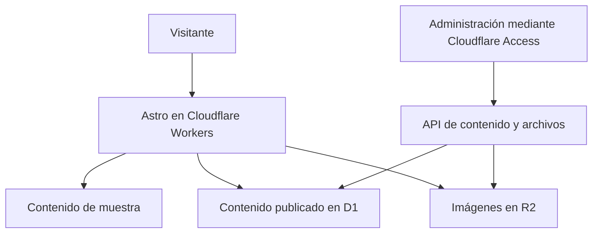

# Trozos con Alma

**Catálogo web de libros personalizados para celebraciones, con gestión de contenidos e imágenes.**

Proyecto construido con Astro y Cloudflare para presentar colecciones de comunión, boda y bautizo, consultar fichas de libros y facilitar el contacto por WhatsApp. El panel de administración permite gestionar colecciones, productos y su publicación.

## Qué demuestra

- Diseño de una experiencia de catálogo orientada a un negocio concreto.
- Renderizado en servidor con Astro y rutas dinámicas.
- Gestión de contenidos con Cloudflare D1 y archivos con R2.
- Validación de JWT de Cloudflare Access en las API de administración.
- Separación entre contenido de muestra y contenido publicado.

## Funcionalidades y estado

| Implementado en el repositorio | Fuera del alcance actual |
| --- | --- |
| Portada, colecciones y fichas de libros | Compra y pago en la web |
| Contacto por WhatsApp | Editor de libros para clientes |
| Panel para crear, editar y eliminar contenido | Confirmación automática de precios y encargos |
| Estados de borrador y publicado | Certificación de disponibilidad de un despliegue |
| Carga de imágenes JPG, PNG y WebP de hasta 8 MB | |
| Registro agregado de eventos por día | |

El catálogo incorpora productos ficticios identificados como muestra. El editor de libros se presenta como una idea futura, no como una función disponible.

## Arquitectura



**Stack:** Astro, TypeScript, Tailwind CSS, Cloudflare Workers, D1, R2, KV y jose.

Las API administrativas verifican emisor, audiencia y firma del JWT recibido en `Cf-Access-Jwt-Assertion`. Es necesario configurar una aplicación y política de Cloudflare Access para utilizar el panel con autenticación.

## Desarrollo local

Requisito declarado en `package.json`: **Node.js >=22.23.4** y npm.

```bash
git clone https://github.com/alejandroomesa/trozos-con-alma.git
cd trozos-con-alma
npm ci
npm run db:migrate:local
npm run dev
```

Abre la dirección que indique Astro en la terminal. Las migraciones con `--local` preparan la base local de Wrangler.

El contenido público combina datos de muestra con registros publicados de D1. La lectura implementa una alternativa con datos de muestra si falla el acceso a la base. El acceso administrativo requiere un JWT válido y su configuración correspondiente; un servidor local por sí solo no proporciona una sesión de Cloudflare Access.

## Configuración de Cloudflare

`wrangler.jsonc` contiene la configuración del despliegue existente. Para utilizar una cuenta propia, configura sus recursos:

| Binding o variable | Finalidad |
| --- | --- |
| `DB` | Base D1 de contenidos y eventos |
| `MEDIA` | Bucket R2 de imágenes |
| `SESSION` | Namespace KV de sesiones |
| `ASSETS` | Archivos generados del sitio |
| `ACCESS_TEAM_DOMAIN` | Dominio del equipo de Cloudflare Access |
| `ACCESS_AUD` | Audiencia de la aplicación Access |
| `R2_ACCOUNT_ID` | Identificador de cuenta para operaciones relacionadas con R2 |

El nombre interno `libros-eventos` se conserva en el paquete y en el worker. No es necesario renombrar recursos para presentar el proyecto como Trozos con Alma.

Las credenciales privadas deben configurarse mediante los mecanismos de secretos de Cloudflare, nunca en archivos públicos. Revisa también el número de contacto de `src/data/contacto.ts` antes de usar una copia como demostración.

## Comandos

| Comando | Acción |
| --- | --- |
| `npm run dev` | Desarrollo local |
| `npm run build` | Compilar el sitio |
| `npm run preview` | Compilar y previsualizar |
| `npm run generate-types` | Generar tipos de bindings |
| `npm run db:migrate:local` | Aplicar migraciones a D1 local |
| `npm run db:migrate:remote` | Aplicar migraciones a la base remota configurada |
| `npm run deploy` | Compilar y desplegar el worker configurado |

Los dos últimos comandos modifican recursos remotos. Úsalos únicamente tras revisar la cuenta y la configuración de destino. No forman parte de la preparación local.

## Comprobación y demostración

`npm run build` comprueba la compilación. El repositorio no define un comando de pruebas automatizadas.

Para revisar el recorrido funcional:

1. Abre portada, una colección y una ficha de libro.
2. Comprueba el comportamiento en móvil y escritorio.
3. Verifica que los productos de muestra estén identificados.
4. Revisa el destino del enlace de WhatsApp sin enviar mensajes.
5. En un entorno de prueba con Access configurado, crea un borrador, añade una imagen y publícalo.
6. Comprueba que el contenido publicado aparece en el catálogo.

Una compilación correcta no valida por sí sola Access, D1, R2 ni un despliegue remoto.

## Estructura

- `src/pages/`: portada, colecciones, libros y administración.
- `src/pages/api/admin/`: contenido y archivos del panel.
- `src/pages/api/analytics/`: registro de eventos.
- `src/lib/public-content.ts`: composición del catálogo público.
- `src/data/`: contenido de muestra y contacto.
- `src/components/`: componentes de presentación.
- `migrations/`: esquema y cambios de D1.
- `wrangler.jsonc`: bindings y configuración de Cloudflare.

Desarrollado en el repositorio de [Alejandro Mesa](https://github.com/alejandroomesa).
